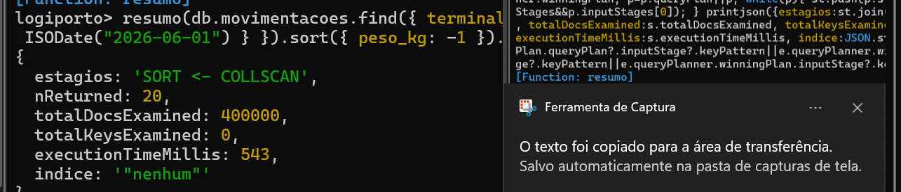
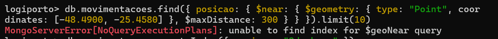
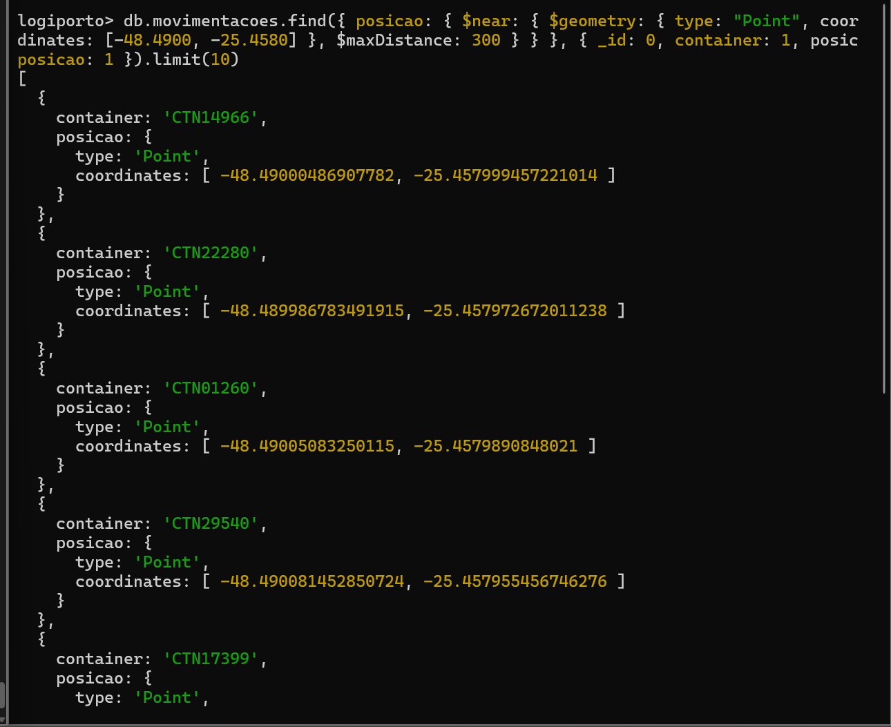
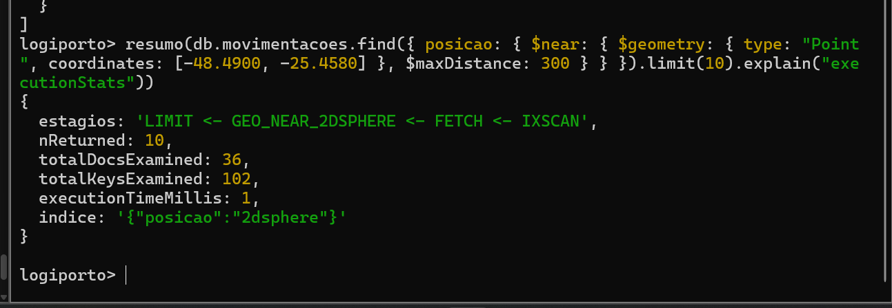

# Prova Prática Integradora - Operação Maré Alta

Banco de Dados NoSQL, 2º Bimestre, Engenharia de Software, 6º Semestre, Unicesumar
Professor Leonardo Rocha

Aluno: Thiago Henrique Velasquez Santana
RA: 241959542

## Parâmetros da minha prova

Saída do logiporto_gerador.js:

```
CLASSE_ALVO   : Granel
TERMINAL_ALVO : T4
DATA_CORTE    : 2026-06-01
INCIDENTE (formato Google Maps 'lat, lon'): -25.4580, -48.4900
CÓDIGO DE AUTENTICIDADE: LP-241959542-19545-33562
```

Primeira linha do grafo.cypher:

```
// BASE_DA_PILHA da sua prova: K8 | EMPRESA SANCIONADA: E2
```

## Ambiente

Usei o MongoDB no contêiner Docker mongo-lab e o Neo4j no contêiner neo4j-lab, os dois das aulas. Meu computador é Windows e rodei os comandos pelo terminal do VS Code.

No PowerShell o sinal `<` não funciona, então rodei o gerador assim:

```
cmd /c "docker exec -i mongo-lab mongosh < logiporto_gerador.js"
```

Para gerar o grafo eu copiei o script para dentro do contêiner e rodei com `--file --quiet`, porque do outro jeito o arquivo .cypher saía com o texto do terminal misturado.

## Uso de IA

Usei IA (Claude) como apoio, com autorização do professor. Todos os comandos e resultados foram rodados no meu computador, com o banco gerado pelo meu RA.

## Arquivos

- README.md: parâmetros, respostas e diário de bordo
- previsoes.md: o que eu esperava antes de rodar cada questão
- consultas_mongodb.js: todos os comandos usados no MongoDB
- evidencias: prints dos resultados

## Parte A - MongoDB

Para não ter que procurar os números no meio do explain, que é bem grande, criei uma função chamada `resumo` que mostra só o que a questão pede. O código dela está no consultas_mongodb.js.

### A1. Painel do pátio

Consulta com os meus parâmetros:

```js
db.movimentacoes.find({
  terminal: "T4",
  classe: "Granel",
  ts: { $gte: ISODate("2026-06-01") }
}).sort({ peso_kg: -1 }).limit(20)
```

a) Sem índice



b) Com o índice na ordem do filtro `{ terminal: 1, classe: 1, ts: 1, peso_kg: -1 }`


c) Com o índice pela regra ESR `{ terminal: 1, classe: 1, peso_kg: -1, ts: 1 }`


d) Comparação

| | a) sem índice | b) ordem do filtro | c) ESR |
|---|---|---|---|
| Estágios | SORT, COLLSCAN | FETCH, SORT, IXSCAN | LIMIT, FETCH, IXSCAN |
| Ordenou na memória | sim | sim | não |
| totalKeysExamined | 0 | 9741 | 30 |
| totalDocsExamined | 400000 | 20 | 20 |
| nReturned | 20 | 20 | 20 |
| executionTimeMillis | 543 | 13 | 12 |

Sem índice o banco precisou ler as 400 mil movimentações, uma por uma, e depois ordenar tudo na memória para achar as 20 mais pesadas.

No item b o índice ajudou a achar os registros, mas não ajudou na ordenação. O índice é uma B-Tree, que guarda as chaves em ordem, campo por campo, na ordem em que foram criados. Terminal e classe são valores fixos, então o próximo campo da árvore é a data. Como eu pedi uma faixa de datas, o banco teve que passar por todas as chaves de T4 e Granel a partir de junho, que deram 9741. Essas chaves estão em ordem de data, não de peso. Por isso o banco ainda precisou ordenar tudo na memória antes de devolver os 20 primeiros.

Uma coisa que eu não esperava: foram lidos só 20 documentos e não os 9741. Como o peso está dentro do índice, o banco ordenou usando as próprias chaves e só depois foi buscar os 20 documentos que ganharam.

No item c usei a regra ESR, que diz para colocar no índice primeiro os campos de igualdade, depois o campo da ordenação e por último o campo de faixa. Ficou terminal, classe, peso e data. Assim, dentro de T4 e Granel as chaves já estão em ordem do mais pesado para o mais leve. O banco só vai descendo pela árvore, pula quem é de antes de junho e para quando junta 20. Por isso não precisou ordenar nada na memória e leu só 30 chaves. As 10 que sobraram eram registros pesados, mas de antes da data de corte.

O tempo do b e do c ficou quase igual porque 9741 chaves ainda é pouco. A diferença que importa é que no c o banco não ordena nada e o trabalho depende só do limit, e não de quantos registros existem no período.

O índice que ficou na coleção no final da A1 foi o ESR.

### A2. Incidente no pátio

O ponto do alarme veio no formato do Google Maps, que mostra primeiro a latitude e depois a longitude: `-25.4580, -48.4900`.

Primeiro rodei a busca antes de ter índice:

```js
db.movimentacoes.find({
  posicao: { $near: {
    $geometry: { type: "Point", coordinates: [-48.4900, -25.4580] },
    $maxDistance: 300
  } }
}).limit(10)
```



Deu o erro `unable to find index for $geoNear query`. Uma busca normal sem índice ainda consegue ler a coleção inteira, mas o `$near` precisa devolver os resultados por ordem de distância, e o MongoDB só faz isso usando um índice geográfico. Sem ele a consulta nem roda.

Depois criei o índice:

```js
db.movimentacoes.createIndex({ posicao: "2dsphere" })
```


Escolhi o `2dsphere` porque o campo posicao está no formato GeoJSON e a distância precisa ser calculada em metros, considerando que a Terra é redonda. O índice `2d` serve para um plano e não trabalha em metros.

Depois testei colando as coordenadas na mesma ordem do Google Maps:

```js
db.movimentacoes.find({
  posicao: { $near: {
    $geometry: { type: "Point", coordinates: [-25.4580, -48.4900] },
    $maxDistance: 300
  } }
}, { _id: 0, container: 1, posicao: 1 }).limit(10).toArray()
```


Voltou vazio e sem nenhum erro. O GeoJSON usa a ordem contrária, primeiro longitude e depois latitude. Com a ordem trocada o banco entende um ponto que existe, mas fica no meio do oceano, bem longe de Paranaguá. Como não tem nada perto de lá, a busca volta vazia sem avisar. Esse é o problema mais perigoso, porque parece que deu certo.

Então rodei com a ordem certa, longitude e depois latitude:

```js
db.movimentacoes.find({
  posicao: { $near: {
    $geometry: { type: "Point", coordinates: [-48.4900, -25.4580] },
    $maxDistance: 300
  } }
}, { _id: 0, container: 1, posicao: 1 }).limit(10)
```




Voltaram os 10 registros mais próximos, já em ordem de distância, sem eu precisar usar sort: CTN14966, CTN22280, CTN01260, CTN29540, CTN17399, CTN56094, CTN46454, CTN48264, CTN14920 e CTN12506. O valor 300 do `$maxDistance` é em metros porque o ponto foi passado em GeoJSON.

Por último, o explain:

```js
db.movimentacoes.find({
  posicao: { $near: {
    $geometry: { type: "Point", coordinates: [-48.4900, -25.4580] },
    $maxDistance: 300
  } }
}).limit(10).explain("executionStats")
```



| | Valor |
|---|---|
| Estágios | LIMIT, GEO_NEAR_2DSPHERE, FETCH, IXSCAN |
| nReturned | 10 |
| totalKeysExamined | 102 |
| totalDocsExamined | 36 |
| executionTimeMillis | 1 |
| Índice | posicao 2dsphere |

O que cada etapa faz, de baixo para cima:

IXSCAN. O índice 2dsphere divide o mapa em pequenas áreas, chamadas células, e guarda em qual célula cada ponto está. O banco calcula quais células ficam em volta do incidente e lê só as chaves delas. Foram 102.

FETCH. Uma célula é uma área aproximada, então um contêiner pode estar na célula certa e mesmo assim passar de 300 metros. Por isso o banco busca os documentos candidatos, que foram 36, para ver a posição exata de cada um.

GEO_NEAR_2DSPHERE. Calcula a distância de verdade de cada candidato, tira quem passou de 300 metros e coloca em ordem. Ele faz isso em anéis, começando pelo mais perto do ponto e indo para fora. Só abre um anel novo se ainda faltar resultado.

LIMIT. Corta em 10. Como os resultados já chegam em ordem, quando completa 10 a busca para.

No fim o banco leu 36 documentos para responder, em vez das 400 mil movimentações.

## Diário de bordo

- O primeiro comando do gerador falhou porque o contêiner mongo-lab estava parado. Resolvi com `docker start mongo-lab`.
- A primeira versão do grafo.cypher saiu com o texto do terminal misturado. Gerei de novo copiando o script para o contêiner e usando `--file --quiet`.
- O Neo4j ainda tinha os dados do exercício da aula (Antena, CoreRouter e Switch). Apaguei tudo com `MATCH (n) DETACH DELETE n` antes de carregar o grafo da prova e conferi 5 terminais, 30 empresas e 90 contêineres.
- A1: na primeira vez esqueci de tirar o print do item b. Apaguei o índice ESR, criei de novo o índice do item b, rodei o explain e depois voltei o ESR.
- A1 b: eu tinha previsto uns 9,7 mil documentos lidos, mas foram só 20. As chaves bateram, 9741. Eu não tinha pensado que, como o peso está no índice, o banco ordena pelas chaves e só busca os documentos no final.
- A2: com as coordenadas na ordem do Google Maps o terminal não mostrou nada, e parecia que o comando nem tinha rodado. Repeti com `.toArray()` para aparecer o `[]`.
- A2: eu tinha previsto centenas de chaves e documentos lidos. Foram 102 chaves e 36 documentos, porque a busca para assim que acha os 10 mais perto, e eles estavam a poucos metros do ponto.
