# Prova Prática Integradora - Operação Maré Alta

Banco de Dados NoSQL, 2º Bimestre, Engenharia de Software, 6º Semestre, Unicesumar
Professor Leonardo Rocha

Aluno: Thiago Henrique Velasquez Santana
RA: 241959542

## Parâmetros da minha prova

Saída do logiporto_gerador.js:

```
CLASSE_ALVO   : Granel
TERMINAL_ALVO : T4
DATA_CORTE    : 2026-06-01
INCIDENTE (formato Google Maps 'lat, lon'): -25.4580, -48.4900
CÓDIGO DE AUTENTICIDADE: LP-241959542-19545-33562
```

Primeira linha do grafo.cypher:

```
// BASE_DA_PILHA da sua prova: K8 | EMPRESA SANCIONADA: E2
```

## Ambiente

Usei o MongoDB no contêiner Docker mongo-lab e o Neo4j no contêiner neo4j-lab, os dois das aulas. Meu computador é Windows e rodei os comandos pelo terminal do VS Code.

No PowerShell o sinal `<` não funciona, então rodei o gerador assim:

```
cmd /c "docker exec -i mongo-lab mongosh < logiporto_gerador.js"
```

Para gerar o grafo eu copiei o script para dentro do contêiner e rodei com `--file --quiet`, porque do outro jeito o arquivo .cypher saía com o texto do terminal misturado.

## Uso de IA

Usei IA (Claude) como apoio, com autorização do professor. Todos os comandos e resultados foram rodados no meu computador, com o banco gerado pelo meu RA.

## Arquivos

- README.md: parâmetros, respostas e diário de bordo
- previsoes.md: o que eu esperava antes de rodar cada questão
- consultas_mongodb.js: todos os comandos usados no MongoDB
- evidencias: prints dos resultados

## Parte A - MongoDB

Para não ter que procurar os números no meio do explain, que é bem grande, criei uma função chamada `resumo` que mostra só o que a questão pede. O código dela está no consultas_mongodb.js.

### A1. Painel do pátio

Consulta com os meus parâmetros:

```js
db.movimentacoes.find({
  terminal: "T4",
  classe: "Granel",
  ts: { $gte: ISODate("2026-06-01") }
}).sort({ peso_kg: -1 }).limit(20)
```

a) Sem índice


b) Com o índice na ordem do filtro `{ terminal: 1, classe: 1, ts: 1, peso_kg: -1 }`


c) Com o índice pela regra ESR `{ terminal: 1, classe: 1, peso_kg: -1, ts: 1 }`


d) Comparação

| | a) sem índice | b) ordem do filtro | c) ESR |
|---|---|---|---|
| Estágios | SORT, COLLSCAN | FETCH, SORT, IXSCAN | LIMIT, FETCH, IXSCAN |
| Ordenou na memória | sim | sim | não |
| totalKeysExamined | 0 | 9741 | 30 |
| totalDocsExamined | 400000 | 20 | 20 |
| nReturned | 20 | 20 | 20 |
| executionTimeMillis | 543 | 13 | 12 |

Sem índice o banco precisou ler as 400 mil movimentações, uma por uma, e depois ordenar tudo na memória para achar as 20 mais pesadas.

No item b o índice ajudou a achar os registros, mas não ajudou na ordenação. O índice é uma B-Tree, que guarda as chaves em ordem, campo por campo, na ordem em que foram criados. Terminal e classe são valores fixos, então o próximo campo da árvore é a data. Como eu pedi uma faixa de datas, o banco teve que passar por todas as chaves de T4 e Granel a partir de junho, que deram 9741. Essas chaves estão em ordem de data, não de peso. Por isso o banco ainda precisou ordenar tudo na memória antes de devolver os 20 primeiros.

Uma coisa que eu não esperava: foram lidos só 20 documentos e não os 9741. Como o peso está dentro do índice, o banco ordenou usando as próprias chaves e só depois foi buscar os 20 documentos que ganharam.

No item c usei a regra ESR, que diz para colocar no índice primeiro os campos de igualdade, depois o campo da ordenação e por último o campo de faixa. Ficou terminal, classe, peso e data. Assim, dentro de T4 e Granel as chaves já estão em ordem do mais pesado para o mais leve. O banco só vai descendo pela árvore, pula quem é de antes de junho e para quando junta 20. Por isso não precisou ordenar nada na memória e leu só 30 chaves. As 10 que sobraram eram registros pesados, mas de antes da data de corte.

O tempo do b e do c ficou quase igual porque 9741 chaves ainda é pouco. A diferença que importa é que no c o banco não ordena nada e o trabalho depende só do limit, e não de quantos registros existem no período.

O índice que ficou na coleção no final da A1 foi o ESR.

### A2. Incidente no pátio

O ponto do alarme veio no formato do Google Maps, que mostra primeiro a latitude e depois a longitude: `-25.4580, -48.4900`.

Primeiro rodei a busca antes de ter índice:

```js
db.movimentacoes.find({
  posicao: { $near: {
    $geometry: { type: "Point", coordinates: [-48.4900, -25.4580] },
    $maxDistance: 300
  } }
}).limit(10)
```


Deu o erro `unable to find index for $geoNear query`. Uma busca normal sem índice ainda consegue ler a coleção inteira, mas o `$near` precisa devolver os resultados por ordem de distância, e o MongoDB só faz isso usando um índice geográfico. Sem ele a consulta nem roda.

Depois criei o índice:

```js
db.movimentacoes.createIndex({ posicao: "2dsphere" })
```

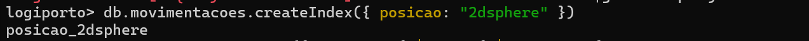

Escolhi o `2dsphere` porque o campo posicao está no formato GeoJSON e a distância precisa ser calculada em metros, considerando que a Terra é redonda. O índice `2d` serve para um plano e não trabalha em metros.

Depois testei colando as coordenadas na mesma ordem do Google Maps:

```js
db.movimentacoes.find({
  posicao: { $near: {
    $geometry: { type: "Point", coordinates: [-25.4580, -48.4900] },
    $maxDistance: 300
  } }
}, { _id: 0, container: 1, posicao: 1 }).limit(10).toArray()
```

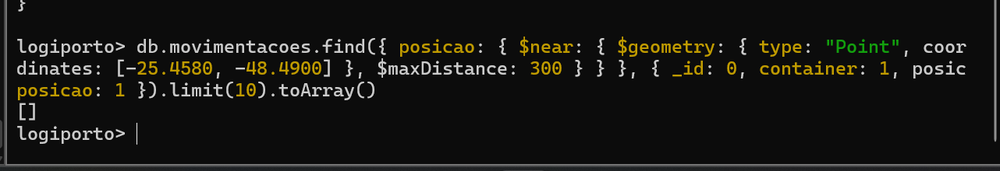

Voltou vazio e sem nenhum erro. O GeoJSON usa a ordem contrária, primeiro longitude e depois latitude. Com a ordem trocada o banco entende um ponto que existe, mas fica no meio do oceano, bem longe de Paranaguá. Como não tem nada perto de lá, a busca volta vazia sem avisar. Esse é o problema mais perigoso, porque parece que deu certo.

Então rodei com a ordem certa, longitude e depois latitude:

```js
db.movimentacoes.find({
  posicao: { $near: {
    $geometry: { type: "Point", coordinates: [-48.4900, -25.4580] },
    $maxDistance: 300
  } }
}, { _id: 0, container: 1, posicao: 1 }).limit(10)
```


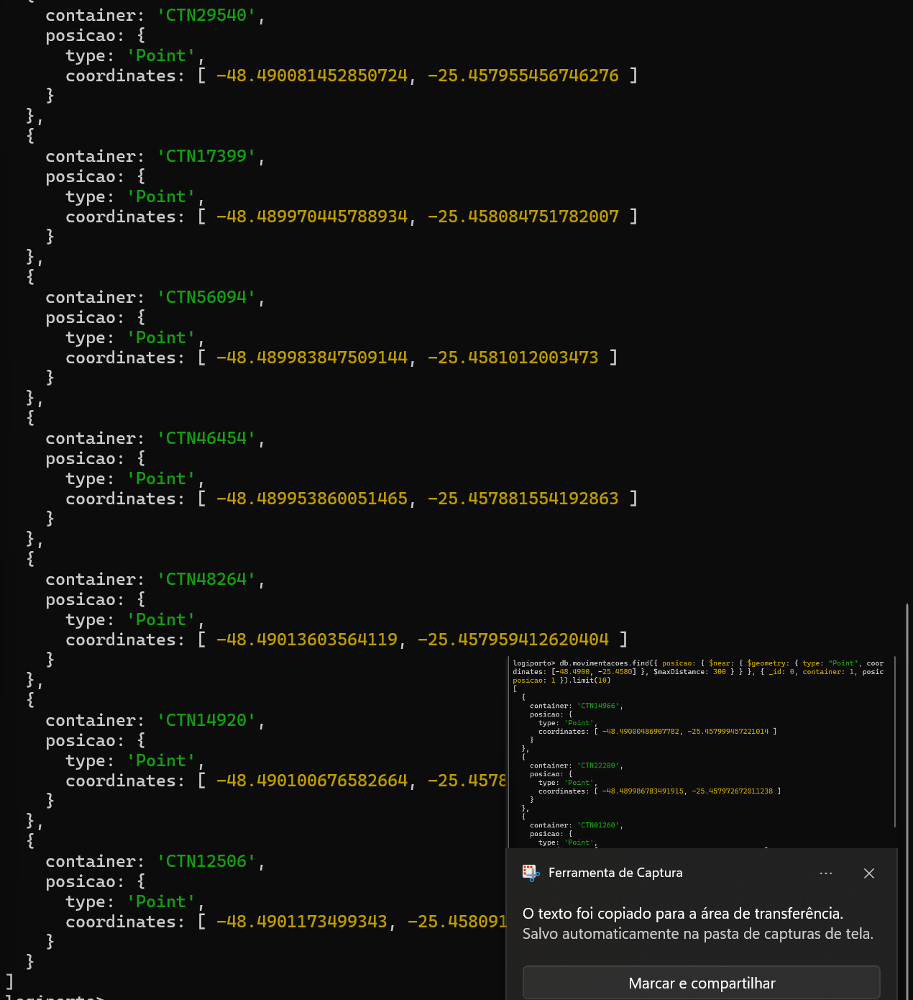

Voltaram os 10 registros mais próximos, já em ordem de distância, sem eu precisar usar sort: CTN14966, CTN22280, CTN01260, CTN29540, CTN17399, CTN56094, CTN46454, CTN48264, CTN14920 e CTN12506. O valor 300 do `$maxDistance` é em metros porque o ponto foi passado em GeoJSON.

Por último, o explain:

```js
db.movimentacoes.find({
  posicao: { $near: {
    $geometry: { type: "Point", coordinates: [-48.4900, -25.4580] },
    $maxDistance: 300
  } }
}).limit(10).explain("executionStats")
```


| | Valor |
|---|---|
| Estágios | LIMIT, GEO_NEAR_2DSPHERE, FETCH, IXSCAN |
| nReturned | 10 |
| totalKeysExamined | 102 |
| totalDocsExamined | 36 |
| executionTimeMillis | 1 |
| Índice | posicao 2dsphere |

O que cada etapa faz, de baixo para cima:

IXSCAN. O índice 2dsphere divide o mapa em pequenas áreas, chamadas células, e guarda em qual célula cada ponto está. O banco calcula quais células ficam em volta do incidente e lê só as chaves delas. Foram 102.

FETCH. Uma célula é uma área aproximada, então um contêiner pode estar na célula certa e mesmo assim passar de 300 metros. Por isso o banco busca os documentos candidatos, que foram 36, para ver a posição exata de cada um.

GEO_NEAR_2DSPHERE. Calcula a distância de verdade de cada candidato, tira quem passou de 300 metros e coloca em ordem. Ele faz isso em anéis, começando pelo mais perto do ponto e indo para fora. Só abre um anel novo se ainda faltar resultado.

LIMIT. Corta em 10. Como os resultados já chegam em ordem, quando completa 10 a busca para.

No fim o banco leu 36 documentos para responder, em vez das 400 mil movimentações.

### A3. O TTL que não apaga

Primeiro olhei como um alerta está gravado:

```js
db.alertas.findOne()
```

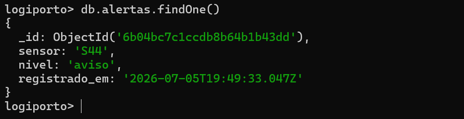

O campo `registrado_em` aparece entre aspas: `'2026-07-05T19:49:33.047Z'`. Isso quer dizer que a data foi gravada como texto, e não como data.

Depois criei o mesmo índice TTL que o desenvolvedor anterior criou, para apagar depois de 30 dias (30 x 24 x 60 x 60 = 2592000 segundos):

```js
db.alertas.createIndex({ registrado_em: 1 }, { expireAfterSeconds: 2592000 })
```

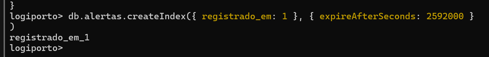

Contei os alertas logo depois e de novo alguns minutos mais tarde. Continuaram 100000, mesmo todos sendo de 2026 e quase todos com bem mais de 30 dias.

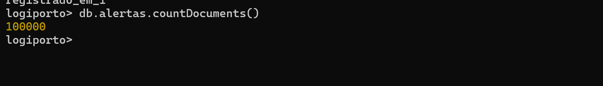

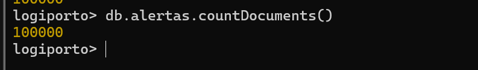

Para comprovar o motivo, contei os alertas pelo tipo do campo:

```js
db.alertas.countDocuments({ registrado_em: { $type: "string" } })
db.alertas.countDocuments({ registrado_em: { $type: "date" } })
```

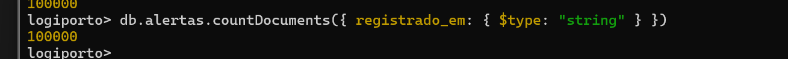

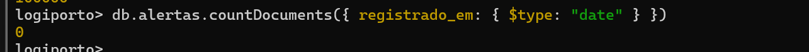

Todos os 100000 estão como texto e nenhum está como data.

Causa raiz. O MongoDB tem uma tarefa que roda sozinha a cada 60 segundos e apaga os documentos vencidos de um índice TTL. Para saber se um documento venceu, ela soma a data do campo com o `expireAfterSeconds` e compara com a hora atual. Essa conta só é feita quando o campo é do tipo Date, ou uma lista de Dates. Se o campo for texto, a tarefa simplesmente ignora o documento, sem dar erro nenhum. Mesmo o texto tendo cara de data, para o banco ele é só um texto. Por isso o índice foi criado sem problema e nada foi apagado.

O comando do índice em si está certo. O que precisa mudar é o jeito de gravar. O índice correto é:

```js
db.alertas.createIndex({ registrado_em: 1 }, { expireAfterSeconds: 2592000 })
```

E a aplicação precisa gravar `registrado_em` como data de verdade, usando `new Date()` ou o tipo de data do driver da linguagem, e não como texto com `toISOString()`:

```js
db.alertas.insertOne({ sensor: "S1", nivel: "aviso", registrado_em: new Date() })
```

Para testar, gravei um alerta do jeito certo com data de 40 dias atrás:

```js
db.alertas.insertOne({ sensor: "TESTE", nivel: "info", registrado_em: new Date(Date.now() - 40*24*60*60*1000) })
db.alertas.countDocuments({ sensor: "TESTE" })
```

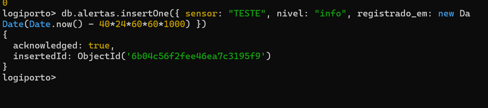

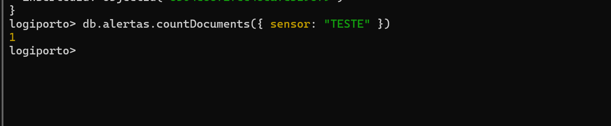

Logo depois de gravar a contagem era 1. Uns dois minutos depois rodei de novo e deu 0. O TTL apagou o alerta gravado como data e continuou ignorando os 100000 gravados como texto.

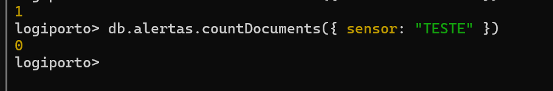

### A4. Consulta coberta

Consulta da questão:

```js
db.movimentacoes.find(
  { tipo: "inspecao", terminal: "T4" },
  { _id: 0, container: 1 }
)
```

Criei um índice com os dois campos do filtro e o campo que a consulta devolve:

```js
db.movimentacoes.createIndex({ tipo: 1, terminal: 1, container: 1 })
```

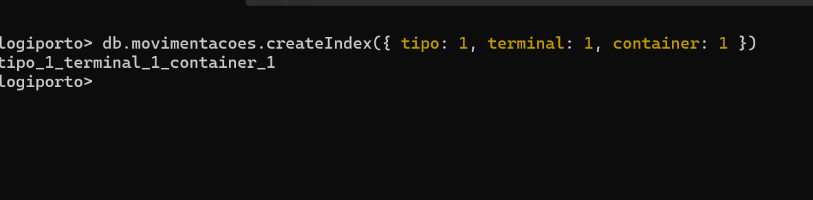

Com `_id: 0` na projeção:

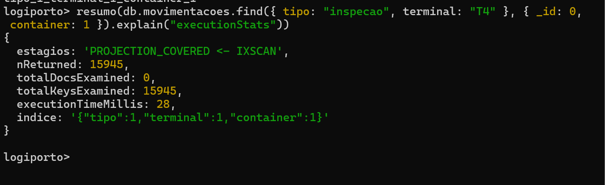

Sem o `_id: 0`, ou seja, `{ container: 1 }`:

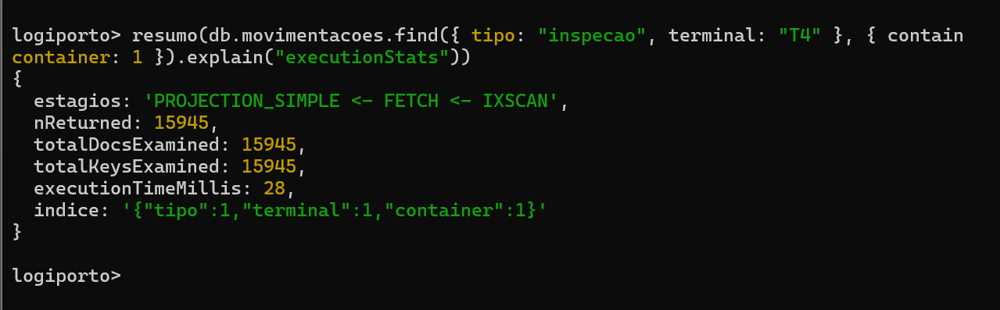

| | com _id: 0 | sem _id: 0 |
|---|---|---|
| Estágios | PROJECTION_COVERED, IXSCAN | PROJECTION_SIMPLE, FETCH, IXSCAN |
| totalKeysExamined | 15945 | 15945 |
| totalDocsExamined | 0 | 15945 |
| nReturned | 15945 | 15945 |

Com `_id: 0` a consulta é coberta. Tudo o que ela precisa está dentro do índice: tipo e terminal para filtrar e container para devolver. O banco lê só as chaves do índice e monta a resposta com elas, sem abrir nenhum documento. Por isso aparece PROJECTION_COVERED e totalDocsExamined fica 0.

Quando eu tiro o `_id: 0`, o MongoDB volta a devolver o `_id`, porque ele vem por padrão em toda consulta. Só que o `_id` não está nesse índice. Então, para cada uma das 15945 chaves, o banco precisa ir no documento buscar o `_id`. Aparece o estágio FETCH e os documentos lidos sobem de 0 para 15945. A consulta deixa de ser coberta só por causa de um campo que eu nem tinha pedido.

O tempo ficou igual nos dois (28 ms) porque os dados cabem na memória do meu computador. Numa coleção maior, ou quando os documentos não estão em memória, cada FETCH é uma leitura a mais no disco, e é aí que a consulta coberta faz diferença.

## Parte B - Aggregation Pipeline

Para o explain do aggregate criei a função `resumoAgg`, parecida com a `resumo` da Parte A. O código está no consultas_mongodb.js.

### B1. Relatório gerencial

Pipeline, usando só os estágios vistos nos Encontros 7 e 8:

```js
const pipelineB1 = [
  // 1. Filtra primeiro, para o índice poder ser usado e menos documentos seguirem
  { $match: { classe: "Granel", ts: { $gte: ISODate("2026-06-01") } } },
  // 2. Agrupa por terminal e calcula os totais
  { $group: {
      _id: "$terminal",
      total_movimentacoes: { $sum: 1 },
      peso_total: { $sum: "$peso_kg" },
      peso_medio: { $avg: "$peso_kg" },
      maior_peso: { $max: "$peso_kg" }
  } },
  // 3. Ordena pelo peso total e fica com os 3 maiores
  { $sort: { peso_total: -1 } },
  { $limit: 3 },
  // 4. Troca o _id pelo campo terminal
  { $project: { _id: 0, terminal: "$_id", total_movimentacoes: 1, peso_total: 1, peso_medio: 1, maior_peso: 1 } }
]
db.movimentacoes.aggregate(pipelineB1)
```

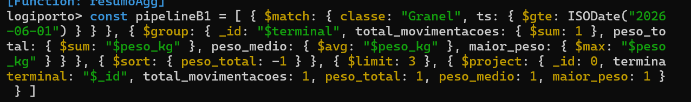

Resultado:

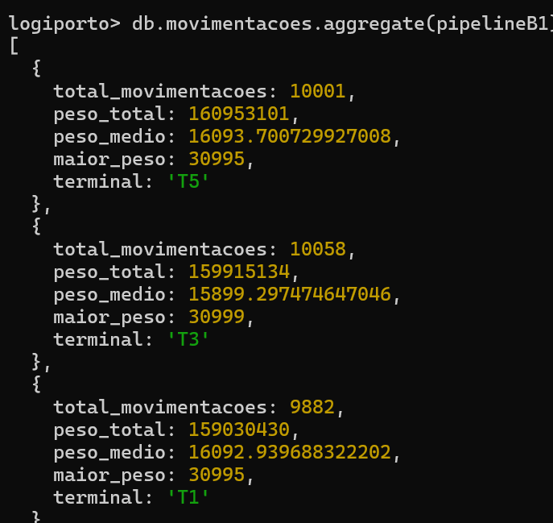

| terminal | total_movimentacoes | peso_total | peso_medio | maior_peso |
|---|---|---|---|---|
| T5 | 10001 | 160953101 | 16093,70 | 30995 |
| T3 | 10058 | 159915134 | 15899,30 | 30999 |
| T1 | 9882 | 159030430 | 16092,94 | 30995 |

O $sort e o $limit vêm depois do $group de propósito. Só dá para saber quais são os 3 maiores depois de somar o peso de todos os terminais.

Explain antes de criar o índice:

```js
db.movimentacoes.explain("executionStats").aggregate(pipelineB1)
```

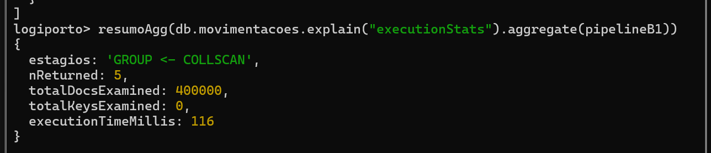

Criei um índice com os dois campos do $match. Classe vem primeiro porque é igualdade e a data depois porque é faixa:

```js
db.movimentacoes.createIndex({ classe: 1, ts: 1 })
```

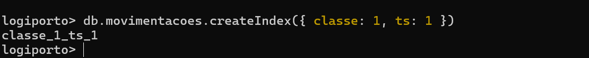

Explain depois do índice:

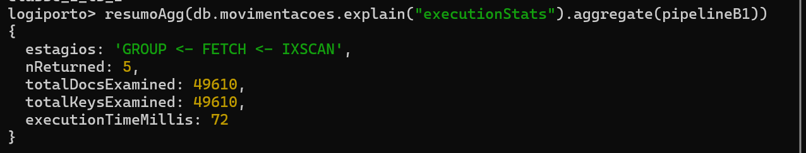

| | sem índice | com índice { classe: 1, ts: 1 } |
|---|---|---|
| Estágios | GROUP, COLLSCAN | GROUP, FETCH, IXSCAN |
| totalKeysExamined | 0 | 49610 |
| totalDocsExamined | 400000 | 49610 |
| Saída do GROUP (nReturned) | 5 | 5 |
| executionTimeMillis | 116 | 72 |

Quantos documentos entraram no $group. Na minha versão do MongoDB o $match e o $group rodam juntos dentro do motor de busca, por isso o explain mostra GROUP direto em cima do FETCH. Tudo o que o FETCH lê e passa adiante entra no GROUP, então entraram 49610 documentos. O nReturned 5 é a saída do GROUP, um grupo para cada terminal, antes do $sort e do $limit deixarem só 3.

Para confirmar, contei os documentos que passam no filtro do $match:

```js
db.movimentacoes.countDocuments({ classe: "Granel", ts: { $gte: ISODate("2026-06-01") } })
```

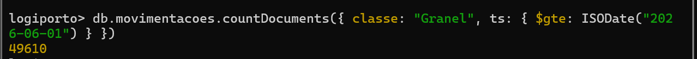

Deu 49610, o mesmo número. Sem o índice o banco lia as 400 mil movimentações para descartar a maioria. Com o índice ele vai direto nas chaves de Granel a partir de junho e só lê os documentos que realmente entram no $group. Nenhuma chave foi lida à toa, porque keys e docs examinados são iguais ao resultado do filtro.

### B2. Debug Arquitetural

a) Rodei o pipeline exatamente como estava na prova:

```js
const pipelineErrado = [
  { $project: { terminal: 1, classe: 1 } },
  { $group: {
      _id: { terminal: "$terminal", classe: "$classe" },
      kg_total: { $sum: "peso_kg" },
      mov: { $sum: 1 }
  } },
  { $limit: 3 },
  { $sort: { kg_total: -1 } },
  { $match: { "_id.classe": "Granel" } }
]
db.movimentacoes.aggregate(pipelineErrado)
```

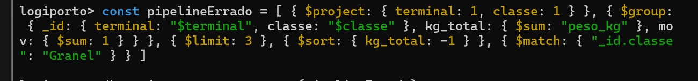

Saída obtida:

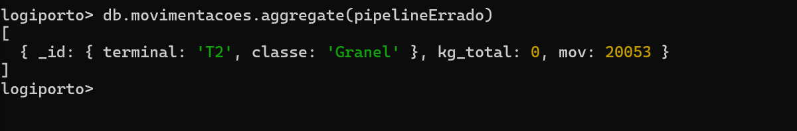

```
[ { _id: { terminal: 'T2', classe: 'Granel' }, kg_total: 0, mov: 20053 } ]
```

Veio só 1 terminal no lugar de 3, e com peso total 0, o que não faz sentido, já que todo contêiner pesa pelo menos 1000 kg.

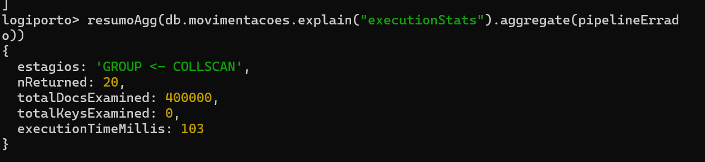

O explain mostra que ele leu as 400 mil movimentações (COLLSCAN) e montou 20 grupos, que são todas as combinações de 5 terminais com 4 classes.

b) Defeitos encontrados

| # | Defeito | Tipo |
|---|---|---|
| 1 | O `$project` do começo só deixa `terminal` e `classe`. O campo `peso_kg` é jogado fora antes do `$group`, então não tem peso nenhum para somar. | Lógica |
| 2 | `$sum: "peso_kg"` está sem o `$`. Sem o `$`, o MongoDB entende o texto "peso_kg" e não o valor do campo. Como texto não é número, o `$sum` ignora e o total dá 0. Mesmo arrumando o defeito 1, continuaria dando 0. | Lógica |
| 3 | O `$limit: 3` vem antes do `$sort`. Ele pega 3 grupos quaisquer, na ordem em que saíram do `$group`, e só depois ordena esses 3. Os 3 maiores podem ter ficado de fora. | Lógica |
| 4 | O `$match` da classe está no final, depois do `$limit`. Ele filtra só os 3 grupos que sobraram. Se entre eles tiver só 1 de Granel, vem só 1, que foi o que aconteceu. | Lógica |
| 5 | O mesmo `$match` no final também deixa tudo lento. Como o filtro não está no começo, o banco não consegue usar o índice e lê as 400 mil movimentações, para depois jogar fora 3/4 delas. | Desempenho |
| 6 | O `$group` agrupa por terminal e classe juntos. Isso cria 20 grupos na memória, sendo que só os 5 de Granel interessam. Com o filtro de classe no começo, basta agrupar por terminal. | Desempenho |

c) Pipeline corrigido

```js
const pipelineCorrigido = [
  // Filtra primeiro: usa o índice { classe: 1, ts: 1 } e só Granel segue
  { $match: { classe: "Granel" } },
  // Agrupa só por terminal, somando o campo de verdade com $
  { $group: { _id: "$terminal", kg_total: { $sum: "$peso_kg" }, mov: { $sum: 1 } } },
  // Ordena antes de cortar
  { $sort: { kg_total: -1 } },
  { $limit: 3 },
  // Saída limpa, com o nome do terminal
  { $project: { _id: 0, terminal: "$_id", kg_total: 1, mov: 1 } }
]
db.movimentacoes.aggregate(pipelineCorrigido)
```

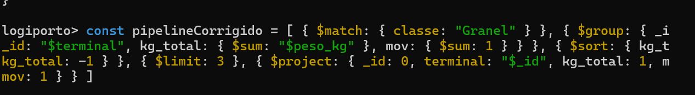

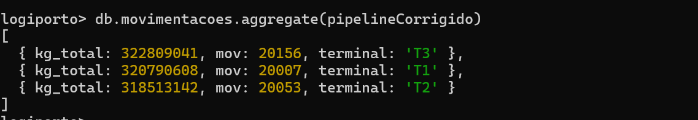

| terminal | kg_total | mov |
|---|---|---|
| T3 | 322809041 | 20156 |
| T1 | 320790608 | 20007 |
| T2 | 318513142 | 20053 |

Não precisei criar índice novo. O índice `{ classe: 1, ts: 1 }` da B1 começa por classe, então serve para um filtro só de classe também.

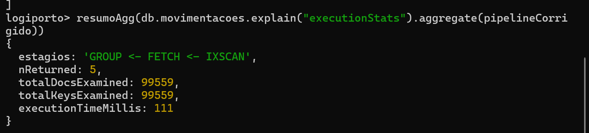

Para provar que o resultado está certo, rodei o mesmo cálculo sem o `$limit`, mostrando os 5 terminais:

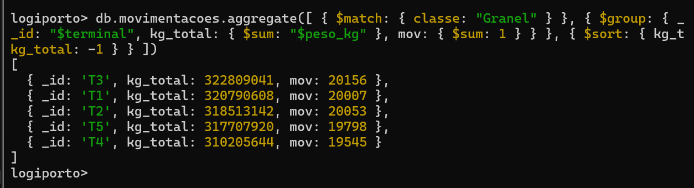

T3, T1 e T2 são mesmo os três maiores. T5 e T4 ficam abaixo. O total de movimentações do T4 deu 19545, o mesmo número que aparece no meu Código de Autenticidade (LP-241959542-19545-33562), que o gerador calcula justamente para Granel no T4. Isso confirma que a contagem bate com o banco gerado pelo meu RA.

Outra coisa que dá para ver: no pipeline errado o T2 aparecia com mov 20053, o mesmo valor do corrigido. A contagem estava certa, o problema era só o peso e a ordem dos estágios.

| | errado | corrigido |
|---|---|---|
| Estágios | GROUP, COLLSCAN | GROUP, FETCH, IXSCAN |
| totalKeysExamined | 0 | 99559 |
| totalDocsExamined | 400000 | 99559 |
| Grupos montados | 20 | 5 |
| Resultado | errado, 1 terminal com peso 0 | certo, 3 terminais |
| executionTimeMillis | 103 | 111 |

d) Impacto da refatoração

Com o `$match` no começo, o MongoDB consegue usar o índice `{ classe: 1, ts: 1 }` e só lê as 99559 movimentações de Granel, em vez das 400 mil. Com isso menos documentos passam pelo pipeline e o `$group` monta 5 grupos em vez de 20, o que diminui o uso de memória RAM, porque cada grupo fica guardado na memória até o fim. Também cai o uso de CPU, já que o banco faz menos comparações e somas. E como o `$sort` vem logo depois do `$group`, ele só ordena 5 itens, e o `$limit` corta no lugar certo. No meu teste o tempo ficou parecido, 103 ms contra 111 ms, e isso tem explicação. Ler 1/4 da coleção pelo índice significa ir buscar cada documento num lugar diferente, enquanto o COLLSCAN lê tudo em sequência, que é rápido quando a coleção cabe na memória. Mesmo assim a versão corrigida lê 75% menos documentos, e essa diferença cresce junto com a coleção. A versão errada sempre vai ler tudo, não importa quantas classes existam.

### Auditoria de índices

Ao terminar as Partes A e B rodei `db.movimentacoes.getIndexes()` para conferir se não ficou nenhum índice de teste sobrando.

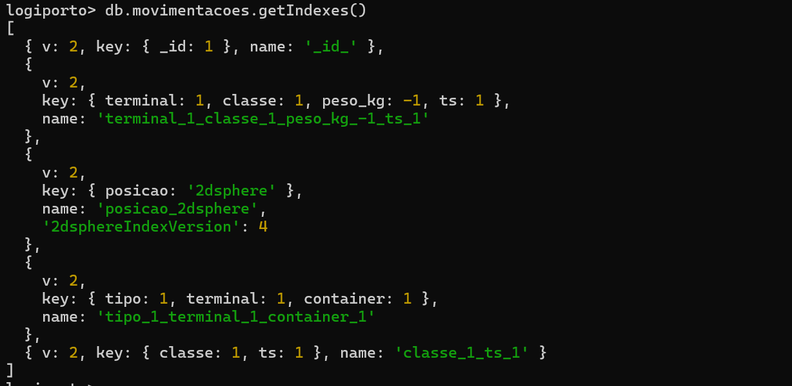

| Índice | Para que serve |
|---|---|
| `_id_` | padrão do MongoDB |
| `terminal_1_classe_1_peso_kg_-1_ts_1` | A1, painel do pátio pela regra ESR |
| `posicao_2dsphere` | A2, busca pelo incidente |
| `tipo_1_terminal_1_container_1` | A4, consulta coberta |
| `classe_1_ts_1` | B1 e B2, primeiro estágio do pipeline |

O índice do item b da A1 (`terminal, classe, ts, peso_kg`) foi apagado, porque ele só existia para a comparação e o ESR faz o mesmo trabalho melhor. Todos os que ficaram são usados por alguma consulta. Na coleção alertas ficou só o índice TTL da A3, que é o índice correto da política de retenção.

## Parte C - Grafos no Neo4j

### C1. Modelagem

Fiz o diagrama em Mermaid, que o GitHub mostra como desenho direto nesta página.

Modelo do grafo:

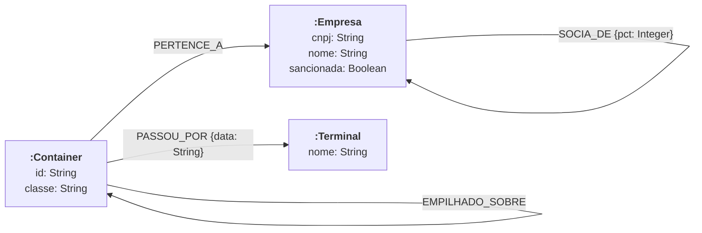

Como ler:

- Caixa é um nó. O nome com dois pontos é o rótulo e embaixo vêm as propriedades.
- Seta é um relacionamento, sempre com direção. O texto da seta é o tipo e, entre chaves, as propriedades dele.
- `(a)-[:SOCIA_DE {pct}]->(b)` quer dizer que a empresa a é sócia da empresa b, com pct por cento de participação.
- `(k)-[:PERTENCE_A]->(e)` quer dizer que o contêiner k é da empresa e.
- `(k)-[:PASSOU_POR {data}]->(t)` quer dizer que o contêiner k passou pelo terminal t naquela data.
- `(a)-[:EMPILHADO_SOBRE]->(b)` quer dizer que o contêiner a está em cima do contêiner b.

Não tem chave estrangeira nem tabela no meio. A participação societária e a data da passagem ficam guardadas no próprio relacionamento, que é como o grafo trata a ligação entre duas coisas.

Exemplo real do meu grafo, a empresa sancionada E2 e os sócios diretos dela:

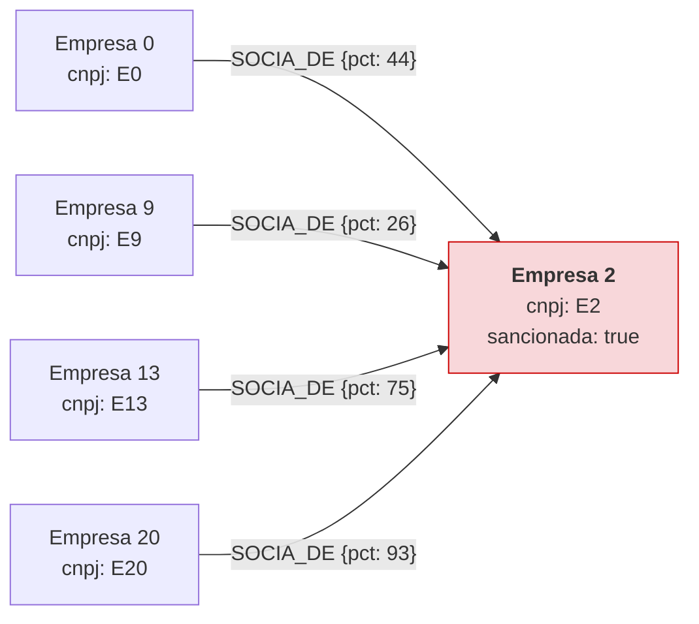

Consulta usada para tirar esses dados do banco:

```cypher
MATCH (s:Empresa {sancionada: true})-[r:SOCIA_DE]-(socio:Empresa)
RETURN socio.nome AS socio, r.pct AS pct, startNode(r) = socio AS socio_aponta_para_E2
```

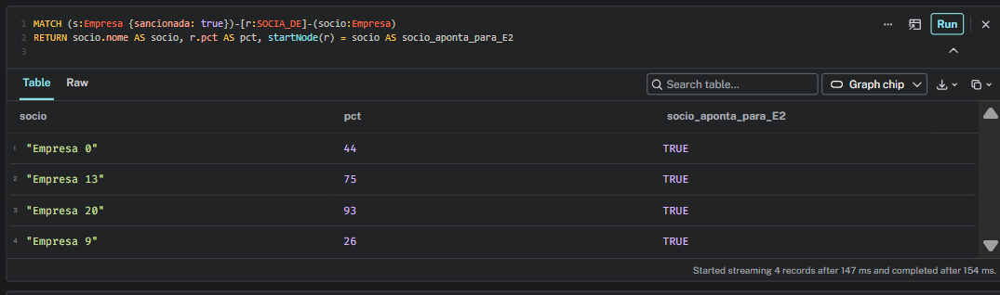

Todas as 4 setas chegam na E2. Ela não é sócia de ninguém, só tem sócios.

### C2. Investigação societária e operacional

```cypher
// 1. Empresas que são sócias da sancionada, direto ou por até 3 níveis
MATCH (x:Empresa)-[:SOCIA_DE*1..3]->(s:Empresa {sancionada: true})
WITH DISTINCT x, s
// 2. Contêiner da empresa x e contêiner da sancionada no mesmo terminal
MATCH (x)<-[:PERTENCE_A]-(kx:Container)-[px:PASSOU_POR]->(t:Terminal)<-[ps:PASSOU_POR]-(ks:Container)-[:PERTENCE_A]->(s)
// 3. Na mesma data
WHERE px.data = ps.data AND x <> s
RETURN DISTINCT x.nome AS empresa, kx.id AS container, t.nome AS terminal, px.data AS data
ORDER BY empresa, data
```

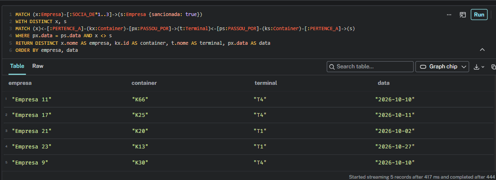

| empresa | container | terminal | data |
|---|---|---|---|
| Empresa 11 | K66 | T4 | 2026-10-10 |
| Empresa 17 | K25 | T4 | 2026-10-11 |
| Empresa 21 | K20 | T1 | 2026-10-02 |
| Empresa 23 | K13 | T1 | 2026-10-27 |
| Empresa 9 | K30 | T4 | 2026-10-10 |

Por que a direção é de fora para dentro, chegando na sancionada. No meu grafo a seta `(a)-[:SOCIA_DE]->(b)` significa que a é sócia de b, ou seja, a é dona de uma parte de b. Numa investigação de sanção o que interessa é quem está por trás da empresa sancionada: os sócios dela, os sócios dos sócios e assim por diante. São essas empresas que podem estar usando outras empresas para continuar operando. Então o caminho tem que seguir as setas até chegar na E2.

Para comprovar, rodei o caminho no sentido contrário, saindo da E2:

```cypher
MATCH (s:Empresa {sancionada: true})-[:SOCIA_DE*1..3]->(x:Empresa)
RETURN count(DISTINCT x) AS empresas_alcancadas
```

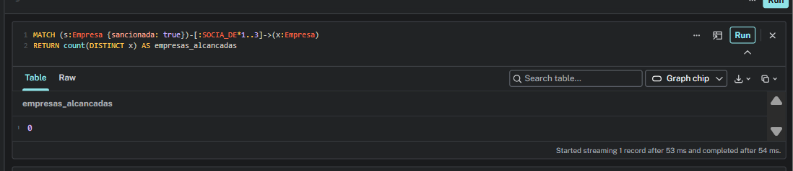

Deu 0. A E2 não tem nenhuma seta saindo, então nessa direção não se chega em ninguém.

Também não usei o caminho sem direção. Sem direção a busca mistura quem é dono da E2 com empresas que só têm um sócio em comum com ela, por exemplo uma empresa que recebe investimento da E20. Isso traz empresas sem relação de controle com a sancionada e aumenta muito o número de caminhos.

Outros cuidados da consulta:

- O limite `*1..3` segue o pedido de até 3 níveis e impede que a busca ande pelo grafo inteiro.
- O `WITH DISTINCT x, s` tira as repetições antes da segunda parte. Uma mesma empresa pode chegar na E2 por mais de um caminho, e sem isso a comparação de contêineres seria feita várias vezes para a mesma empresa.
- O `RETURN DISTINCT` garante que não vem linha repetida no resultado.
- O `x <> s` impede que a própria sancionada apareça como investigada.

### C3. Debug Cypher

Rodei esta questão depois de terminar a C1 e a C2.

#### Trecho (i). Registrar que E1 é sócia de E2

```cypher
CREATE (a:Empresa {cnpj:'E1'})-[:SOCIA_DE {pct:30}]->(b:Empresa {cnpj:'E2'})
```

Sintoma. Antes de rodar havia 30 empresas.

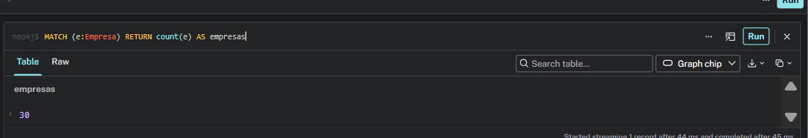

O Neo4j respondeu "Created 2 nodes", quando o certo seria não criar nenhuma empresa, só a ligação.

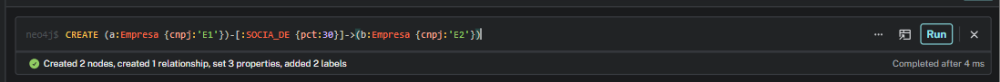

Procurando E1 e E2 aparecem as originais, com nome, e cópias sem nome e sem a informação de sancionada. Sem querer eu rodei o comando duas vezes, por isso vieram 2 cópias de cada.

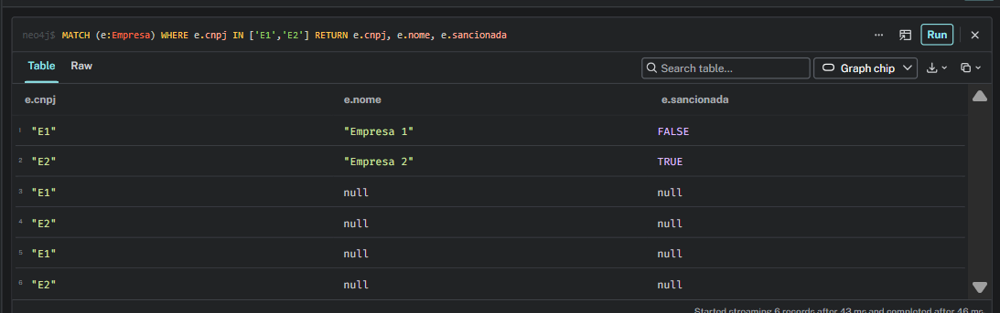

Causa raiz. O `CREATE` sempre cria tudo o que está escrito no padrão, nós e relacionamento. Escrever `(a:Empresa {cnpj:'E1'})` dentro de um `CREATE` não procura a empresa que já existe, cria uma nova com esse cnpj. A ligação foi feita entre duas empresas novas e vazias, e as empresas de verdade continuaram sem a ligação. Cada vez que o comando roda, cria mais duas cópias.

Limpeza das cópias, conforme a prova pede antes de rodar a correção:

```cypher
MATCH (e:Empresa) WHERE e.nome IS NULL DETACH DELETE e
```

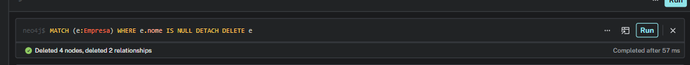

Apagou as 4 cópias e as 2 ligações falsas.

Código corrigido:

```cypher
MATCH (a:Empresa {cnpj:'E1'}), (b:Empresa {cnpj:'E2'})
MERGE (a)-[r:SOCIA_DE]->(b)
ON CREATE SET r.pct = 30
RETURN a.nome, r.pct, b.nome
```

Primeiro o `MATCH` encontra as duas empresas que já existem. Depois o `MERGE` cria a ligação só se ela ainda não existir. Se o comando rodar de novo, não duplica nada. O `ON CREATE SET` coloca o pct só quando a ligação é criada.

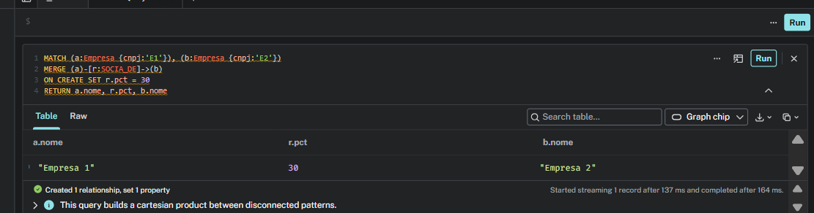

Evidência. Criou só 1 relacionamento, entre Empresa 1 e Empresa 2, e o total voltou a ser 30 empresas.

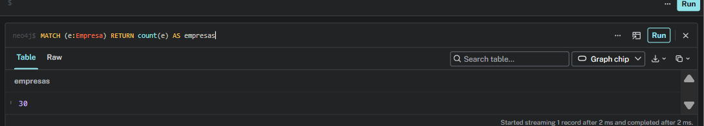

O Neo4j mostrou um aviso de "produto cartesiano" porque o `MATCH` tem dois padrões separados. Aqui não tem problema, já que cada um encontra uma empresa só, 1 x 1 = 1 combinação. Para evitar cópias de vez, o ideal seria também criar uma regra de cnpj único com `CREATE CONSTRAINT FOR (e:Empresa) REQUIRE e.cnpj IS UNIQUE`. Aí um `CREATE` errado daria erro em vez de duplicar.

Essa nova ligação E1 para E2 não muda o resultado da C2. A Empresa 1 já estava na lista, chegando na E2 por outro caminho, e nenhuma empresa nova passa a ficar a 3 níveis ou menos da E2.

#### Trecho (ii). Empresas ligadas à sancionada

```cypher
MATCH (s:Empresa {sancionada:true})-[:SOCIA_DE*]-(x:Empresa) RETURN x.nome
```

Sintoma. Rodei com `LIMIT 20`, como a prova orienta, para não travar o Neo4j:

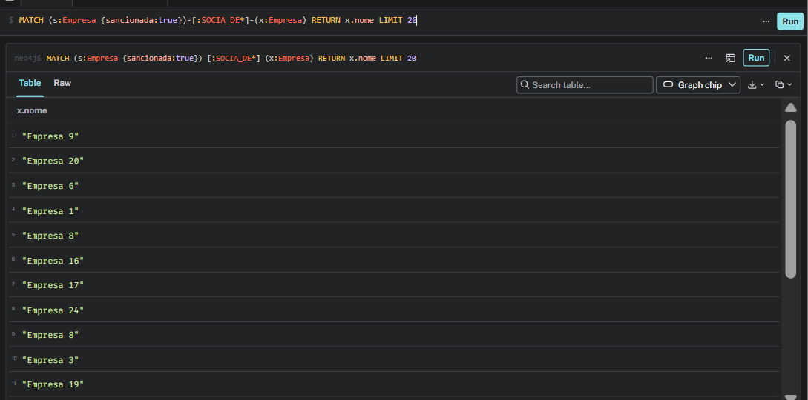

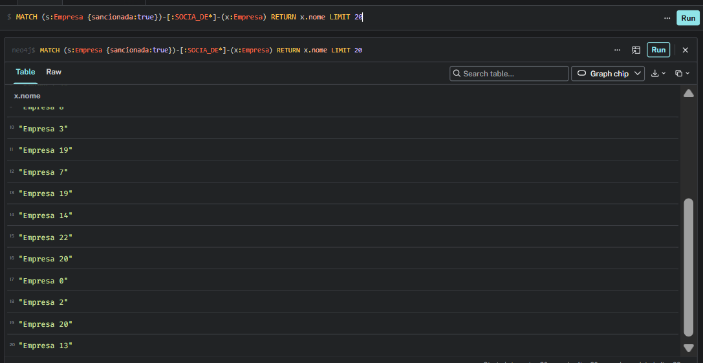

Em só 20 linhas já tem empresa repetida, como Empresa 8, Empresa 19 e Empresa 20, e aparece até a Empresa 2, que é a própria sancionada.

Causa raiz. São três problemas juntos:

- `*` sem limite. O Neo4j tenta seguir caminhos de qualquer tamanho.
- Sem direção, com `-` no lugar de `->`. Cada ligação pode ser percorrida para os dois lados, então ele anda pelo grafo inteiro, de sócio para investida e de volta.
- Sem `DISTINCT`. O Neo4j devolve uma linha para cada caminho encontrado, não para cada empresa. A mesma empresa aparece uma vez para cada caminho diferente que chega nela, e caminhos que dão a volta trazem a própria E2.

Com 30 empresas e 45 ligações, o número de caminhos possíveis cresce muito rápido. Por isso, sem o LIMIT, a consulta pode consumir muita memória e travar.

Código corrigido:

```cypher
MATCH (x:Empresa)-[:SOCIA_DE*1..3]->(s:Empresa {sancionada:true})
RETURN DISTINCT x.nome ORDER BY x.nome
```

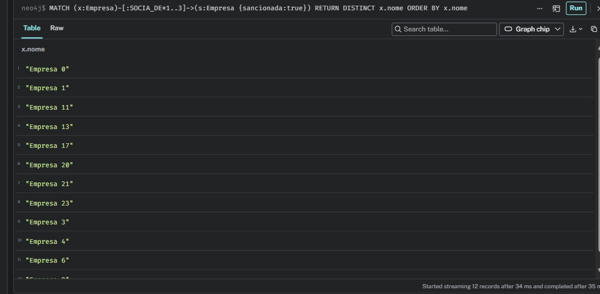

Evidência. Voltaram 12 empresas, sem repetição e sem a E2: Empresa 0, 1, 3, 4, 6, 9, 11, 13, 17, 20, 21 e 23. São as mesmas empresas que a primeira parte da C2 usa. A direção chegando na E2 está justificada na C2.

#### Trecho (iii). Contêineres presos em cima da base

```cypher
MATCH (base:Container {id:'K8'})-[:EMPILHADO_SOBRE*1..3]->(x:Container) RETURN x.id
```

Troquei 'BASE_DA_PILHA' pela minha base, K8.

Sintoma. Não voltou nada, "No changes, no records".

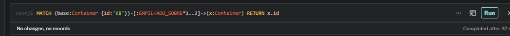

Causa raiz. A seta está ao contrário. No grafo, `(a)-[:EMPILHADO_SOBRE]->(b)` quer dizer que a está em cima de b, então a seta sai do contêiner de cima e aponta para o de baixo. O K8 é a base da pilha, não está em cima de ninguém, por isso não sai nenhuma seta dele. A consulta procurava o que está embaixo da base, e embaixo da base não tem nada.

Código corrigido, invertendo a seta para buscar quem aponta para a base:

```cypher
MATCH (base:Container {id:'K8'})<-[:EMPILHADO_SOBRE*1..3]-(x:Container)
RETURN x.id ORDER BY x.id
```

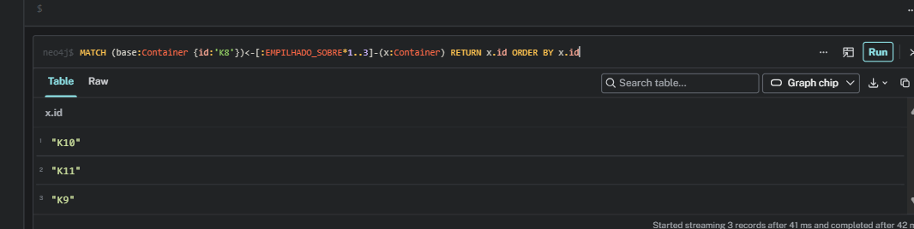

Evidência. Voltaram K9, K10 e K11. O K9 está direto em cima do K8, o K10 em cima do K9 e o K11 em cima do K10. Se o K8 for retirado, os três ficam presos.

#### Trecho (iv). Contêineres perigosos distintos por terminal

```cypher
MATCH (k:Container)-[:PASSOU_POR]->(t:Terminal) WHERE k.classe = 'Perigoso' RETURN t.nome, count(k)
```

Sintoma. Os números vêm maiores do que deveriam.

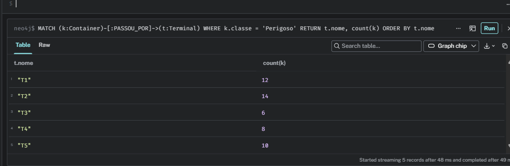

Causa raiz. O `MATCH` devolve uma linha para cada passagem, ou seja, para cada relacionamento PASSOU_POR, e o `count(k)` conta linhas. Cada contêiner tem 2 passagens, e às vezes as duas foram no mesmo terminal, em datas diferentes. Nesse caso o mesmo contêiner aparece em 2 linhas daquele terminal e é contado 2 vezes. A pergunta é quantos contêineres diferentes, e não quantas passagens.

Código corrigido:

```cypher
MATCH (k:Container)-[:PASSOU_POR]->(t:Terminal) WHERE k.classe = 'Perigoso'
RETURN t.nome, count(DISTINCT k) ORDER BY t.nome
```

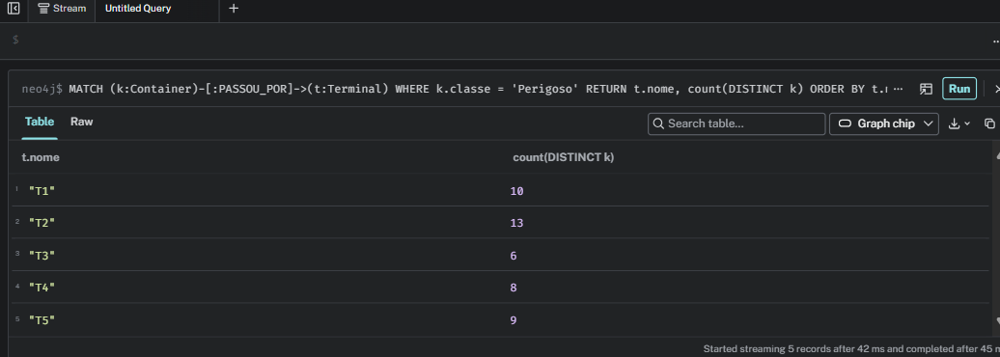

Evidência

| terminal | count(k), antes | count(DISTINCT k), depois |
|---|---|---|
| T1 | 12 | 10 |
| T2 | 14 | 13 |
| T3 | 6 | 6 |
| T4 | 8 | 8 |
| T5 | 10 | 9 |

T1, T2 e T5 tinham contêineres perigosos contados duas vezes. No T1, por exemplo, o K14 passou duas vezes (dias 09 e 19 de outubro) e o K73 também (dias 13 e 14). T3 e T4 não mudaram porque nenhum contêiner perigoso passou duas vezes por eles.

## Diário de bordo

- O primeiro comando do gerador falhou porque o contêiner mongo-lab estava parado. Resolvi com `docker start mongo-lab`.
- A primeira versão do grafo.cypher saiu com o texto do terminal misturado. Gerei de novo copiando o script para o contêiner e usando `--file --quiet`.
- O Neo4j ainda tinha os dados do exercício da aula (Antena, CoreRouter e Switch). Apaguei tudo com `MATCH (n) DETACH DELETE n` antes de carregar o grafo da prova e conferi 5 terminais, 30 empresas e 90 contêineres.
- A1: na primeira vez esqueci de tirar o print do item b. Apaguei o índice ESR, criei de novo o índice do item b, rodei o explain e depois voltei o ESR.
- A1 b: eu tinha previsto uns 9,7 mil documentos lidos, mas foram só 20. As chaves bateram, 9741. Eu não tinha pensado que, como o peso está no índice, o banco ordena pelas chaves e só busca os documentos no final.
- A2: com as coordenadas na ordem do Google Maps o terminal não mostrou nada, e parecia que o comando nem tinha rodado. Repeti com `.toArray()` para aparecer o `[]`.
- A2: eu tinha previsto centenas de chaves e documentos lidos. Foram 102 chaves e 36 documentos, porque a busca para assim que acha os 10 mais perto, e eles estavam a poucos metros do ponto.
- A3: minha hipótese do pré-registro, de que o campo estava gravado como texto, se confirmou. O primeiro sinal foi o findOne mostrar a data entre aspas.
- A3: o alerta de teste não some na hora. A tarefa do TTL roda a cada 60 segundos, então esperei uns dois minutos antes de contar de novo.
- A4: a previsão de uns 16 mil registros bateu, foram 15945. O estágio sem o `_id: 0` apareceu como PROJECTION_SIMPLE em vez de só PROJECTION, mas o importante, o FETCH, apareceu como eu esperava.
- B1: eu tinha previsto uns 49 a 50 mil documentos entrando no $group, e foram 49610. No começo estranhei o nReturned 5 no explain, achei que fosse o número de documentos que entraram. Depois entendi que, nessa versão do MongoDB, o $group roda junto com a busca e o nReturned é a saída do grupo, um por terminal. Confirmei a entrada contando os documentos do $match.
- B2: previ que o pipeline errado ia trazer 0 ou 1 documento, com peso 0. Veio 1 documento (T2), com peso 0.
- B2: esperava que o pipeline corrigido também ficasse mais rápido, mas o tempo foi parecido (103 ms contra 111 ms). Entendi que buscar 1/4 dos documentos pelo índice, um por um, custa parecido com ler a coleção inteira em sequência quando tudo está na memória. O ganho real aparece em documentos lidos e em grupos na memória.
- C2: eu tinha previsto a direção chegando na E2, porque no script ela só aparece no campo "para" das sociedades, e o teste no sentido contrário deu 0 como eu esperava. Previ entre 0 e 5 registros e vieram 5.
- C3 (i): rodei o CREATE com defeito duas vezes sem perceber e acabaram sendo criadas 4 empresas falsas em vez de 2. Isso acabou mostrando bem o problema, porque cada execução duplica de novo. Apaguei as 4 com o DETACH DELETE antes de rodar a versão com MERGE.
- C3 (ii): no print grande do Neo4j os resultados ficaram empilhados e repetidos, então recortei só a parte de cada consulta para as evidências.
