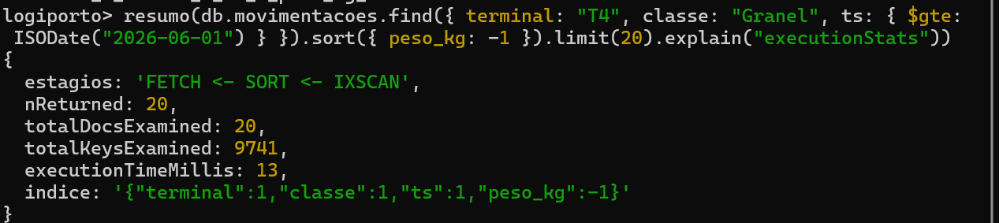
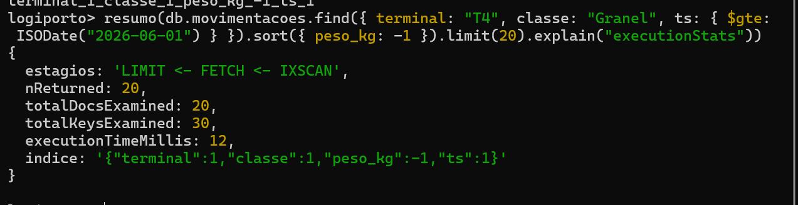

# Prova Prática Integradora - Operação Maré Alta

Banco de Dados NoSQL - 2º Bimestre - Engenharia de Software (6º Semestre) - Unicesumar
Prof. Leonardo Rocha

Aluno: Thiago Henrique Velasquez Santana
RA: 241959542

## Parâmetros da minha prova

Saída do logiporto_gerador.js:

```
CLASSE_ALVO   : Granel
TERMINAL_ALVO : T4
DATA_CORTE    : 2026-06-01
INCIDENTE (formato Google Maps 'lat, lon'): -25.4580, -48.4900
CÓDIGO DE AUTENTICIDADE: LP-241959542-19545-33562
```

Primeira linha do grafo.cypher (grafo_gerador.js):

```
// BASE_DA_PILHA da sua prova: K8 | EMPRESA SANCIONADA: E2
```

## Ambiente

- MongoDB rodando no contêiner Docker mongo-lab (banco logiporto, coleções movimentacoes e alertas)
- Neo4j rodando no contêiner Docker do Encontro 6
- Windows, comandos executados pelo PowerShell

Observação: no PowerShell o operador `<` não funciona, então os scripts foram executados com `cmd /c "docker exec -i mongo-lab mongosh < logiporto_gerador.js"`. Para o grafo, o script foi copiado para dentro do contêiner e executado com `--file --quiet`, porque pela entrada padrão o mongosh gravava os prompts junto no arquivo .cypher.

## Uso de IA

Utilizei IA (Claude) como apoio na resolução, com autorização do professor. Todas as consultas, métricas e resultados foram executados no meu próprio ambiente, com o dataset gerado a partir do meu RA.

## Estrutura

- README.md - parâmetros, ambiente e diário de bordo
- previsoes.md - previsões registradas antes de executar cada questão
- (demais arquivos serão adicionados conforme as questões forem resolvidas)

## Parte A - Auditoria e Indexação no MongoDB

Para não precisar procurar os números no meio do JSON do explain, usei uma função auxiliar no mongosh que imprime a sequência de estágios do plano vencedor e as métricas pedidas. O código dela está em `consultas_mongodb.js`.

### A1. Painel do pátio

Consulta usada (com os meus parâmetros):

```js
db.movimentacoes.find({
  terminal: "T4",
  classe: "Granel",
  ts: { $gte: ISODate("2026-06-01") }
}).sort({ peso_kg: -1 }).limit(20)
```

a) Sem nenhum índice além do `_id`:


b) Índice na ordem do filtro `{ terminal: 1, classe: 1, ts: 1, peso_kg: -1 }`:



c) Índice pela regra ESR `{ terminal: 1, classe: 1, peso_kg: -1, ts: 1 }`:



d) Comparação

| | a) sem índice | b) ordem do filtro | c) ESR |
|---|---|---|---|
| Plano | SORT <- COLLSCAN | FETCH <- SORT <- IXSCAN | LIMIT <- FETCH <- IXSCAN |
| SORT em memória | sim | sim | não |
| totalKeysExamined | 0 | 9.741 | 30 |
| totalDocsExamined | 400.000 | 20 | 20 |
| nReturned | 20 | 20 | 20 |
| executionTimeMillis | 543 | 13 | 12 |

No a) o banco não tem por onde começar, então lê os 400 mil documentos, filtra um por um e ainda ordena em memória para pegar os 20 mais pesados.

No b) o índice resolve bem o filtro, mas não a ordenação. A B-Tree guarda as chaves ordenadas campo por campo, na ordem em que foram declarados. Com `terminal` e `classe` fixos por igualdade, o próximo campo é `ts`, e como o filtro de `ts` é uma faixa (`$gte`), o banco percorre todas as chaves de T4/Granel a partir de 01/06, que foram 9.741. Dentro dessa faixa as chaves estão ordenadas por data, e o `peso_kg` só fica ordenado dentro de cada valor de `ts` igual (o que quase nunca se repete). Então o resultado sai do índice fora da ordem de peso, e o MongoDB precisa de um estágio SORT bloqueante: ele lê as 9.741 chaves inteiras antes de devolver o primeiro resultado. Um detalhe que eu não tinha previsto: como `peso_kg` está dentro do índice, o SORT foi feito em cima das próprias chaves e só depois o FETCH buscou os 20 documentos vencedores. Por isso deu 20 documentos examinados, e não os ~9,7 mil que eu tinha colocado na previsão.

No c) a ordem dos campos segue a regra ESR: primeiro os campos de igualdade (`terminal`, `classe`), depois o campo de ordenação (`peso_kg`, já com -1, que é a direção pedida no sort) e por último o de faixa (`ts`). Assim, dentro de T4/Granel as chaves já estão na B-Tree em ordem decrescente de peso. O banco percorre o índice nessa ordem, descarta pelas próprias chaves as entradas com `ts` anterior a 01/06 e para assim que junta 20 resultados. Por isso o SORT some do plano e só 30 chaves foram examinadas: as 10 a mais são registros pesados mas de antes da data de corte, que foram pulados. O custo deixa de depender de quantas movimentações existem no período e passa a depender só do `limit`.

O tempo do b) e do c) ficou parecido (13 ms e 12 ms) porque 9.741 chaves ainda é pouco para a máquina. A diferença real está em keys examinadas e na ausência do SORT, que é o que pesa quando o volume cresce ou quando várias consultas rodam ao mesmo tempo.

Índice que ficou na coleção ao final da A1: `{ terminal: 1, classe: 1, peso_kg: -1, ts: 1 }`.

## Diário de bordo

- Primeira tentativa de rodar o gerador falhou porque o contêiner mongo-lab estava parado. Resolvido com `docker start mongo-lab`.
- Primeira geração do grafo.cypher saiu com os prompts do mongosh misturados ao Cypher. Gerei de novo copiando o script para o contêiner e usando `--file --quiet`.
- O Neo4j do contêiner neo4j-lab ainda tinha os nós do exercício de aula (Antena, CoreRouter, Switch). Apaguei tudo com `MATCH (n) DETACH DELETE n` antes de carregar o grafo da prova e conferi 5 Terminal, 30 Empresa e 90 Container.
- A1: na primeira rodada esqueci de registrar o explain do item b). Removi o índice ESR, recriei o índice do item b), rodei o explain, depois removi e recriei o ESR.
- A1 b): previ que seriam examinados uns 9,7 mil documentos, mas foram só 20. As keys bateram (9.741). O que eu não considerei é que o `peso_kg` está no índice, então o SORT ordenou as chaves e o FETCH só aconteceu depois, para os 20 primeiros.
